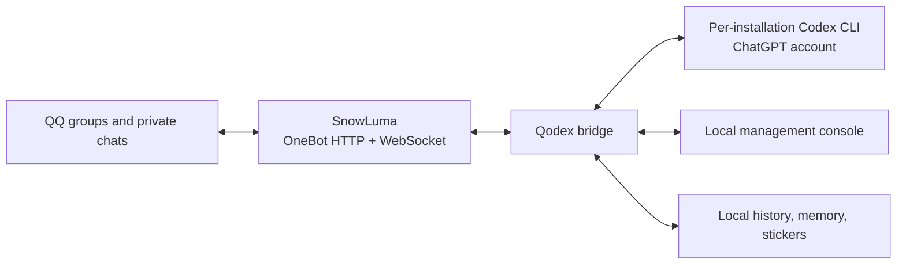
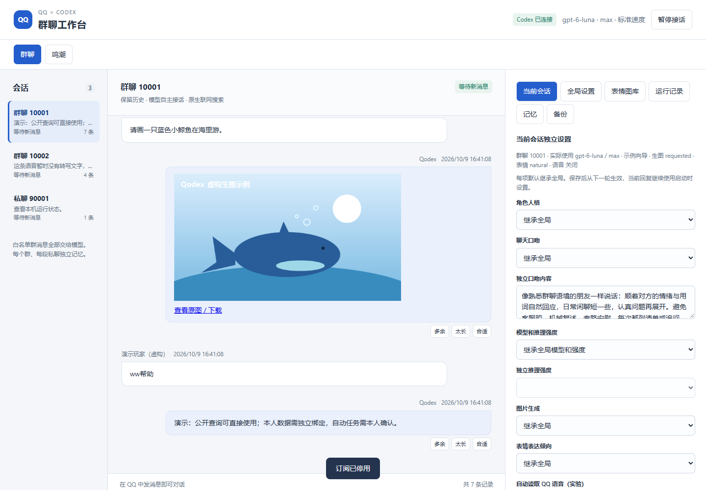
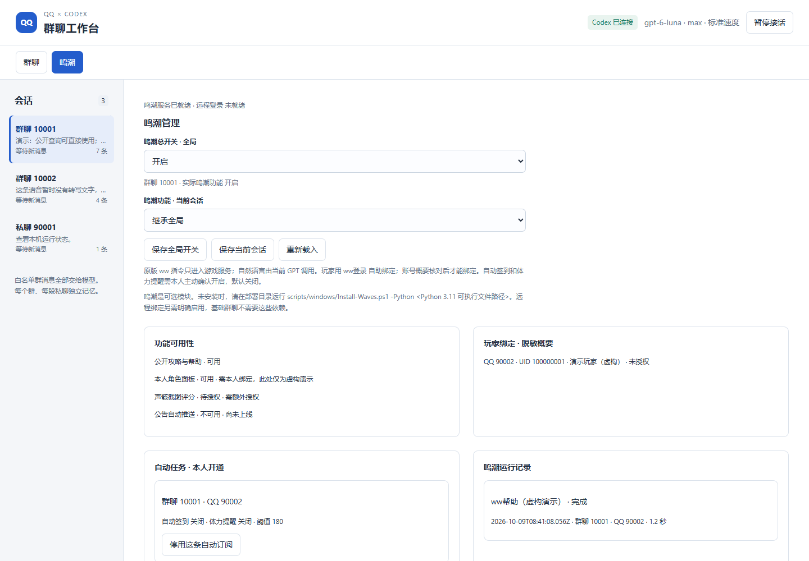

# Qodex

Qodex is a local Windows bridge that connects QQ group and private messages through SnowLuma to Codex. For each allowed conversation, the model decides whether to reply, stay silent, search the web, or interpret an image. Administrators manage access, style, memory, stickers, and history in a local web console.

**中文说明:** [README.md](README.md) · **Preview:** `qodex-v0.5.0` · **Supported deployment:** Windows with your own QQ and Codex ChatGPT login

This is a public fork of [Derpyu520/qq-bridge](https://github.com/Derpyu520/qq-bridge) based on upstream commit [`dea3ce8`](https://github.com/Derpyu520/qq-bridge/commit/dea3ce8). It is not an official SnowLuma, QQ, or OpenAI product. The upstream revision has no explicit `LICENSE` file; see [third-party notices](THIRD_PARTY_NOTICES.md) before assuming redistribution rights.



## Highlights

- Chat and optional Wuthering Waves areas share conversation selection and retain unsaved drafts across area switches. Save each setting explicitly. Games are disabled by default; remote self-service binding is a separate explicit opt-in.
- When enabled, explicit `ww` commands use the game handler exclusively. Natural-language requests let the current chat model select a game tool and use upstream results. Public read-only queries, own-account queries, extra authorization requirements and unavailable operations are distinguished in the [support matrix](docs/WAVES.md).
- QQ voice transcription is **experimental and disabled by default**. Conversation overrides may inherit, enable or disable it. SnowLuma requests QQ-native text, retaining source metadata and visible failures without storing audio. Historical evidence shows received voice messages with failed transcription, including failures in the local QQ client; the cause is unresolved and stable ASR is not promised. See [voice notes](docs/VOICE.md).
- An independent Codex context, history, and long-term memory per QQ group or private chat. Each conversation can inherit or override the global model, reasoning effort, persona, and expression style. Global speed and context-compaction settings apply to all conversations.
- Item-based memory with sources, revisions, pinning, disabling, and version restore. Up to 30,000 characters of active memory are stored per conversation; relevant items are retrieved for each turn. Reply feedback can be recorded and undone. This local learning does not train the underlying model.
- A shared sticker library. The model may send up to two saved stickers per reply and inspect up to two previously unannotated sticker images per turn. Automatic collection is limited to OneBot images explicitly marked as stickers in allowed groups, stops adding at 100, and excludes ordinary photos and private images. The gallery has search, learning status, notes, and global or per-conversation disable controls; disabling does not delete QQ favorites.
- Native Codex image generation and editing using an image from the current conversation. Public installs default to generation only when a user explicitly requests it; administrators may disable or allow proactive generation. Generated images are stored under this installation's `state/generated-images`, with at most one sent per turn. A generation in one group does not block text replies in another.
- Merged-forward reading for current messages and same-conversation quoted forwards. The console shows expanded content, partial failures, and reading time. The model can join open group topics without an @, while still choosing to stay silent. Instructions inside forwarded content have no management authority.
- A local console for access lists, settings, persistent global and conversation pause, cancelling an active reply, history, run records, memory, and selective JSON backup and restore. The backup can optionally include history; it omits local credential files, login state, and image binaries, but its text may still be private.
- Native Codex web search and image input. Model replies and searches are decisions, not guarantees. Closing the browser console does not stop the bridge.

These console screenshots use fixture data, not real QQ conversations.





[Experimental voice UI](assets/qodex-voice-v050.png)

[Console overview](assets/qodex-console-v030.png) · [Item memory](assets/qodex-memory-v030.png) · [Sticker gallery](assets/qodex-gallery-v030.png) · [Backup and restore](assets/qodex-backup-v030.png) · [Forwarded messages and run record](assets/qodex-features-v040.jpg).

## Install on Windows

Install [Git for Windows](https://git-scm.com/download/win), Node.js 24 or newer, the official [Codex CLI](https://developers.openai.com/codex/cli), and [SnowLuma](https://github.com/SnowLuma/SnowLuma/releases/latest) separately. Sign in to Codex with a **ChatGPT account** and sign in to QQ through SnowLuma yourself. API-key-only Codex authentication is unsupported. Qodex neither bundles these executables nor accepts their terms for you.

```powershell
git clone https://github.com/ChrisZ-123/Qodex.git
cd Qodex
npm ci
powershell -NoProfile -ExecutionPolicy Bypass -File .\scripts\windows\Login-Codex.ps1
powershell -NoProfile -ExecutionPolicy Bypass -File .\Setup.ps1
```

The login step uses the official Codex command with a separate home at `state/codex-home`; it does not copy desktop credentials. Existing saved conversation preferences are retained, while missing image options default to requested generation and natural sticker use. See the [v0.4.0 upgrade and rollback guide](docs/UPGRADE_V040.md) for optional migration of old native model sessions and full backup instructions.

For the optional game integration, install Python 3.11 x64 separately, then run:

```powershell
powershell -NoProfile -ExecutionPolicy Bypass -File .\scripts\windows\Install-Waves.ps1 -Python "C:\Python311\python.exe"
# Add -RemoteLogin only if you explicitly want remote self-service binding.
```

The installer downloads pinned upstream source and author resources from official/author sources into this deployment's `state/waves`; no third-party binaries or game assets are bundled. Finish Qodex setup first; restart Qodex after installing to load its secure key, then enable games separately in the console. [gsuid_core](https://github.com/Genshin-bots/gsuid_core), [XutheringWavesUID](https://github.com/Loping151/XutheringWavesUID), [RoverSign](https://github.com/Loping151/RoverSign), [RoverReminder](https://github.com/Loping151/RoverReminder), and [ScoreEcho](https://github.com/Loping151/ScoreEcho) use GPL-3.0; exact commits and scoped adapter/patch notices are in [third-party notices](THIRD_PARTY_NOTICES.md). This does not relicense the inherited repository root.

Automatic sign-in and stamina reminders default to off. Binding, sign-in, unlinking and subscriptions require the requesting user to confirm; the three-minute window limits new confirmation input, not completion of an already accepted task. There is no email delivery, other-game automation or automatic announcement subscription. Remote binding uses an opt-in temporary Quick Tunnel without an uptime guarantee; it does not expose the console or game RPC.

Before upgrading v0.4.0, stop and back up the full installation, external memory and private state. See [v0.5.0 upgrade/rollback](docs/UPGRADE_V050.md). Activating model game tools creates a new native context at the next idle point/new thread with the latest 100 effective messages and retrieved memory; all local history, memory and the old binding remain for rollback. Disabled conversations retain their bindings. JSON backup remains v1-compatible with v0.4.0; voice flags/optional transcription history and game toggles are included, while audio, account credentials, tickets, subscriptions, image binaries and remote-login enablement are excluded. Restore does not activate automatic tasks.

In SnowLuma, enable the loopback OneBot HTTP API (default `127.0.0.1:3000`) and WebSocket server (default `127.0.0.1:3001`). The wizard asks for endpoints, Codex executable, optional SnowLuma launcher, administrator, allow lists, and model settings. Enter the OneBot token in its secure prompt; it is stored using Windows DPAPI rather than in the public JSON template. If only an unsupported `.cmd` wrapper is detected, select the native Codex executable. The Windows wizard requires literal `127.0.0.1` with explicit, distinct ports for OneBot HTTP, WebSocket, SnowLuma WebUI, the console, and the control service; `localhost` and IPv6 addresses are not accepted. Existing configuration is validated on a later wizard run and is not overwritten by default.

Double-click `Qodex.bat` to open the Windows launcher, then click Start and Open Console. The local console and control interface default to ports `3100` and `3110`. Empty allow lists deny messages by default. The console lists account-available models and reasoning efforts. Saving a global choice applies to the next turn for conversations that inherit it; an individual conversation can override the model and effort. An active turn keeps its settings snapshot; a concurrent edit may require refreshing before saving. Reset affects only the selected conversation: pending replies are cancelled, history/persona/long-term memory remain, and pre-reset history is excluded from the new model context. Already sent QQ messages are not recalled.

The suggested model is `gpt-6-luna` with `max` effort and default speed; optional `priority` may affect your shared Codex quota and does not guarantee a fixed runtime improvement. Qodex checks availability and does not automatically fall back. Node 24.18.1, `codex-cli 0.155.0-alpha.16`, and SnowLuma 1.14.17 were recorded for the first preview release; this is not a v0.5.0 compatibility claim for a fresh machine or other versions.

For daily operations, use `powershell -NoProfile -ExecutionPolicy Bypass -File .\scripts\windows\Control.ps1 -Action Status` (or `Start`, `Stop`, `Verify`, `OpenConsole`, `OpenSnowLuma`, `EnableAutoStart`, `DisableAutoStart`). `npm start`, `npm stop`, `npm run status`, and `npm run setup` call the same Windows scripts and preserve DPAPI token handling. To manually edit the model configuration, console port, or control port, Stop with the old configuration first, then edit, Start, and Verify. Sleep and loss of network stop live replies. For v0.3.0 to v0.4.0, stop Qodex, back up the complete installation and external memory directories, update to the fixed tag, complete the separate official login, and choose whether to migrate native model sessions. Qodex Codex authentication now lives under this installation's state/codex-home.

Detailed documentation: [deployment](docs/DEPLOYMENT.md) · [v0.5.0 upgrade and rollback](docs/UPGRADE_V050.md) · [Waves](docs/WAVES.md) · [experimental voice](docs/VOICE.md) · [configuration](docs/CONFIGURATION.md) · [console API](docs/CONSOLE_API.md) · [troubleshooting](docs/TROUBLESHOOTING.md) · [project guide](docs/PROJECT_GUIDE.md) · [security](SECURITY.md). The detailed operational documents are currently in Chinese.
