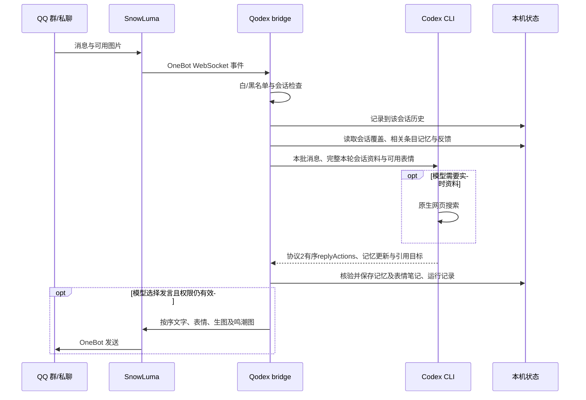

# 项目指南

Qodex `qodex-v0.6.0` 是基于 [Derpyu520/qq-bridge 提交 dea3ce8](https://github.com/Derpyu520/qq-bridge/commit/dea3ce8) 的公开预览 fork。当前受支持的发布路径是 **Windows + SnowLuma OneBot + 本部署独立 Codex ChatGPT 登录 + `conversationMode: model`**。鸣潮为默认关闭的可选Python3.11模块，语音转写默认关闭且实验性。源码中保留了一些 DSH 时代的内部模块和脚本，供改造过程参考；这些不是本版安装所需或受支持的后端接口。不要运行旧 `setup-dsh.mjs` 作为 Qodex 安装步骤。

## 消息路径

每个 `group:<id>` 或 `private:<id>` 有独立 Codex 会话、历史和最多 30,000 字符的有效长期记忆。新增消息排入该会话的下一轮；本轮由同一个聊天模型决定是否发言及是否更新记忆，没有额外判断或记忆模型。群与私聊的长期记忆互不读取。全局模型、人格和口吻可由单个会话覆盖；速度及原生压缩阈值为全局设置，表情库与备注仍全局共享。模型回复和搜索都不保证发生。Codex 使用同一 ChatGPT 账号的共享额度。

记忆以带来源和修订历史的 schema 2 条目保存。首次读取旧文件时留下 `.legacy-v1.json` 原始副本再转换；条目分类为 fact/person/episode/topic，关联真实 QQ、来源/证据和话题状态；旧条目按 fact 读取，旧来源与版本保留。检索保留置顶，优先当前发言者的人物条目，其余按 BM25 正相关选择，已结束话题不进入普通检索、无命中不灌入全部笔记。默认注入目标6000字符/最多12条非置顶，置顶超预算仍保留。模型只能修改本轮检索可见、未置顶、且有本轮来源消息依据的条目。反馈作为当前会话下一轮的柔性表达提示，不是训练。已确认发出的机器人历史才可成为补充证据，尚未发送的计划不算经历。运行记录按会话保存输入摘要、阶段、耗时、搜索、实际检索条目、有序动作及已发送/失败/未发送结果。

QQ 图片可作为当前消息输入。表情学习只会读取本轮实际附上的、尚无本地备注的收藏目录图，每轮最多两张。自动收藏仅处理白名单群中 OneBot 标为表情的图片；普通群图和私聊图不自动收藏。达到 100 张停止自动新增，既有收藏不会自动删除。模型每轮最多选择两张目录内的表情发送，表情笔记供允许的会话共用，但不应包含群友隐私。

## 主要文件

| 路径 | 作用 |
| --- | --- |
| `src/bridge.js` | OneBot 连接、白名单、消息处理、本机控制台与旧模块的入口。 |
| `src/codex-client.js` / `src/codex-rpc.js` | 启动隔离的 Codex app-server，会话、模型检查及事件转换。 |
| `src/model-chat.js` / `src/model-forward.js` | 每会话队列、接话/静默、历史、合并转发、原生生图与同轮记忆处理。 |
| `src/generated-images.js` | 生成图片的会话归属、格式、大小与本机路径验证。 |
| `src/chat-memory.js` / `src/memory-store.js` | 条目记忆协议、schema 2 迁移、修订、30,000 字符限制与按需检索。 |
| `src/model-preferences.js` / `src/model-backup.js` | 分会话覆盖、反馈、持久暂停、表情禁用及白名单格式备份与恢复。 |
| `src/sticker-collector.js` / `src/sticker-learning.js` / `src/sticker-lib.js` | 表情自动收藏、看图笔记和目录管理。 |
| `public/model-console.html` / `public/model-controls.js` | 本机控制台；全局与分会话设置、条目记忆、反馈、运行记录、图库和备份。 |
| `Install.bat` / `scripts/windows/Install.ps1` | 中文引导依赖检查、npm ci、独立登录检查、Setup 和启动页；全局软件/登录仍由用户完成。 |
| `scripts/windows/` | 设置、启动、状态、验证、停止、修复 Codex 连接和可选自动启动。 |
| `config.example.json` | 脱敏配置模板。真实 `config.json`、`state/` 不提交。 |

Codex 子进程使用 `state/codex-home` 内独立的官方 ChatGPT 登录，启动时检查 `account/read`、分页 `model/list` 与所选推理强度，创建会话时禁止模型回退。发布模式下不向 Codex 暴露 QQ MCP 发送工具；QQ 发送由桥接在检查当前权限和暂停状态后执行。进程级配置关闭 shell、插件、连接器、计算机操作和多智能体能力，并使用只读沙箱；原生网页搜索仍可使用。经本轮确认的生图任务只开放原生图片能力。实际安全边界应结合代码与本机配置审阅，控制台/OneBot 服务只绑定本机回环地址。

## 本地数据与验证

`state/` 包含会话映射、聊天历史、分会话覆盖和反馈、表情资料、生成图片、独立 Codex 登录、DPAPI 令牌状态及日志。`chatMemory.directory` 默认是仓库根目录下的 `state/chat-memory`；显式相对路径也从仓库根目录解析，绝对路径按原值使用。迁移或升级前须备份**旧源码、`config.json`、整个 `state/`、自定义角色及任何仓库外记忆目录**。控制台 JSON 备份只包含允许的章节，不含图片本体、本机凭据文件或 Codex 登录态，文本仍需自行检查敏感信息，不能作为完整回退镜像。`state/` 被 Git 忽略但属于本机敏感资料。参阅[升级与回退指南](UPGRADE_V060.md)与[接口说明](CONSOLE_API.md)。

变更后先运行聚焦检查；发布回归入口是 `npm test`，Windows 部署脚本检查是 `npm run test:deployment`。这些检查不代替新机器、真实 QQ 和第三方版本的联调。贡献前参阅[贡献指南](../CONTRIBUTING.md)、[安全说明](../SECURITY.md)与[来源及许可说明](../THIRD_PARTY_NOTICES.md)。

## 可选模块布局

`integrations/waves` 保存发布Python适配器与上游派生补丁，按目录范围GPL-3.0声明。`scripts/windows/Install-Waves.ps1` 下载固定上游源码与作者资源；运行环境、素材与私人状态进入本部署 `state/waves/{core,venv,data,inputs,results,browsers}`，不捆绑进仓库。全局/会话游戏开关独立存于 `state/waves-settings.json`，默认关闭；端口与远程绑定使用 `config.waves`，远程启用默认false。

游戏工具只在已启用会话的新原生线程声明；服务端注册工具不等于每个会话可调用。首次启用在空闲点迁移，载入最近100条有效消息及检索记忆，保留完整本地历史与旧绑定。未安装/未启用会话保持旧聊天流程。明确ww指令与普通模型聊天互斥处理；结果发送仍检查本人来源、会话、白名单、暂停、取消与归属。语音使用SnowLuma原生接口，不追加第二个识别模型。

Python直接导入上游core/plugin，适配源码与补丁纳入 `integrations/waves` GPL-3.0。Node不导入/链接Python模块，不共享内存对象或游戏账号库，通过独立本机认证HTTP服务传递指令、输入和可展示结果；基础群聊不依赖该服务，Python服务可独立运行。分进程本身不构成GPL豁免，授权组合边界见[第三方说明](../THIRD_PARTY_NOTICES.md)。

## v0.6.0 回复与恢复边界

`protocolVersion:2` 的 `replyActions` 顺序由模型决定：最多4段文字/2张不同表情/1张生成图/20张不同鸣潮图，可保持空数组。整轮资源与结构先校验，再逐次检查任务、取消、暂停、访问和禁用，失败停止余下发送、不自动重试；仅首条实际消息附引用。`replyMode` 全局为 natural/single，会话null继承，缺省natural；single是模型指令，不是输出后拼接。每轮提供真实时间/时区和来源 QQ，昵称不是身份键。

Codex 初始化精确识别 `workspace routing discovery failed/timed out`，沿用已有健康检查协调单次初始化与并发合并；不把登录失败或其他超时泛化。原生硬性上下文耗尽只隔离旧任务，在下批新消息建立新线程并注入最近100条有效历史及检索记忆；失败批次不重放，旧绑定/历史保留，不批量重置所有会话。

Windows RepairCodex只管理所属桥接/Codex，遵守端口归属、并发合并与停止竞争，QQ/鸣潮/隧道保持运行；代理只对新子进程生效。鸣潮作者授权与玩家凭据分离，DPAPI保存且不导出；本人直接ww修改指令与模型发起修改的确认边界见[鸣潮说明](WAVES.md)。
